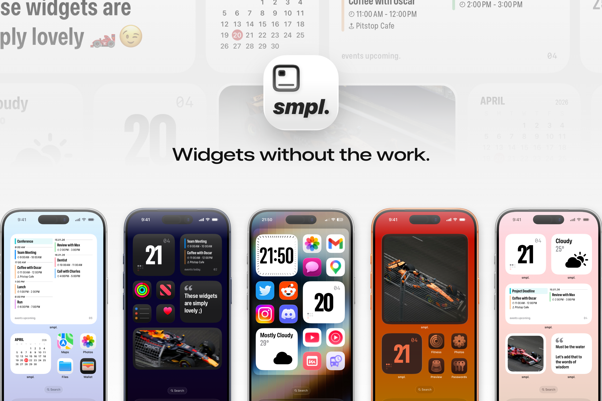

# smpl. widgets

Minimal iOS home screen widgets that look good the second you add them.

I got tired of widget apps that make you design your whole home screen from scratch on a phone screen. smpl. goes the other way: every widget is designed up front, so you add it and you're done. Customisation is kept to a few choices that actually matter, like colour scheme, accent colour and photo framing.

## Widgets

| Widget | What it shows | Sizes |
|---|---|---|
| **smpl.calendar** | Today's day, month and date | Small |
| **smpl.month.calendar** | The current month at a glance | Small |
| **smpl.events** | Upcoming events from the calendars you pick | Small, Medium, Large |
| **smpl.weather** | Current weather and temperature, via WeatherKit | Small |
| **smpl.quote** | A quote you write yourself | Small, Medium, Large |
| **smpl.image** | A photo you've saved and cropped in the app | Small, Medium, Large |
| **smpl.countdown** | Days left until something you're waiting for | Small |
| **Date & time control** | A Control Centre button for the date and time | Control |

The minimal calendar and countdown widgets are free. A single one-time purchase unlocks the rest.

## Privacy

There are no accounts, analytics or ads. Calendar events, location and photos stay on your device and are only used to draw the widgets. The full policy is at [smpl.tnitish.com/privacy-policy](https://smpl.tnitish.com/privacy-policy).

## How it's built

Everything is SwiftUI and WidgetKit, with no third-party dependencies.

- **`smpl-widgets/`** is the container app. It handles permissions, the photo crop editor, widget settings and the purchase flow.
- **`appwidgets/`** is the widget extension. Each widget lives in its own folder with an entry, timeline provider, widget definition and view.
- **`Shared/`** holds the code both targets need, like settings and saved images, shared through an App Group so the app and widgets stay in sync.
- **`website/`** is the static privacy policy page, deployed on Cloudflare Pages.

Widget designs are prototyped in Figma before they're built, so each one has a fixed layout instead of a pile of options.
